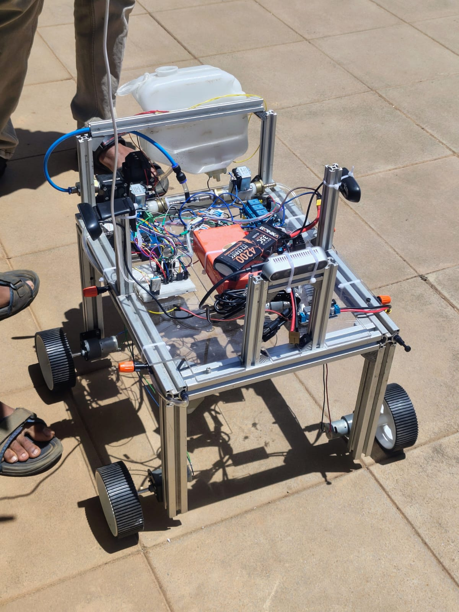
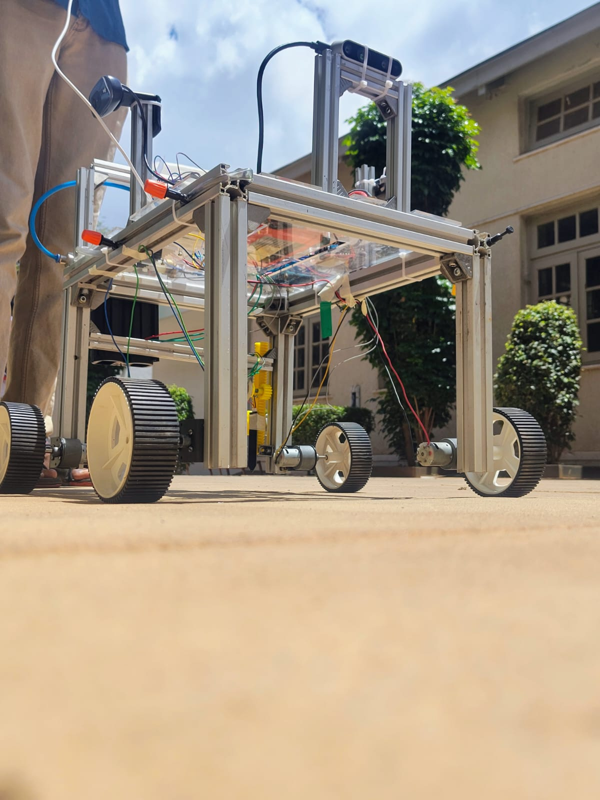
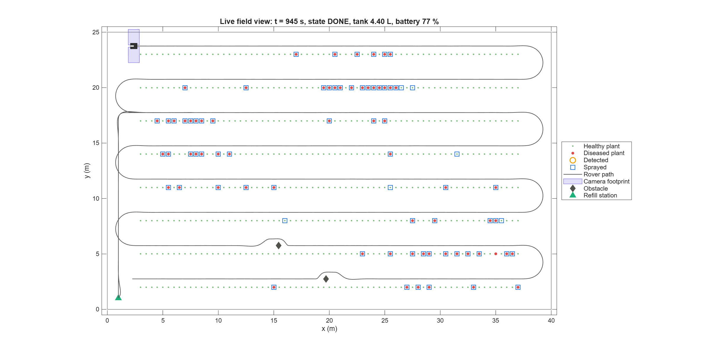
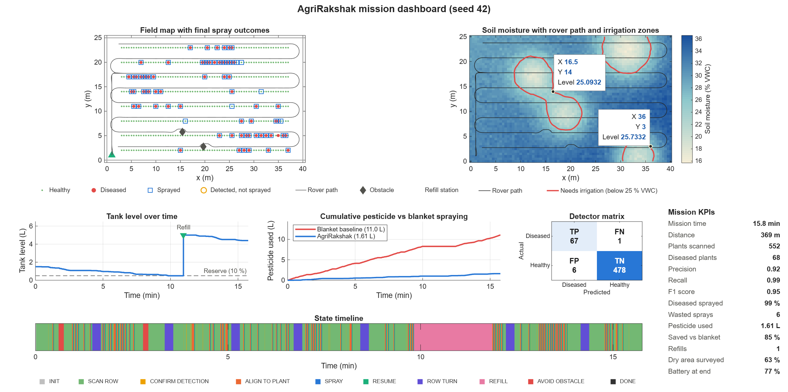

# 🌾 AgriRakshak: AI-Powered Autonomous Crop Health & Precision Intervention Rover

> **A Field-Deployable Smart Farming Assistant for Early Disease Detection, Soil Health Monitoring, and Targeted Pesticide Spraying**

---

## 🌍 Overview

India's farmers face recurring, large-scale crop losses from undetected diseases, pests, nutrient deficiencies, and climate stress — with crop damage repeatedly crossing **5+ million hectares annually** (peaking at 11.42 mha in 2019-20) due to floods, droughts, and heat waves, compounded by pest/disease losses of **15–25% of annual yield** in Indian field studies.

**AgriRakshak** is an autonomous, field-deployable AI rover that closes this gap by scanning every plant for disease and pests, sensing soil moisture and nutrients in real time, and responding with **targeted, plant-level pesticide spraying** — all through **on-device AI intelligence** that works even without internet connectivity. Paired with the **AgriSense dashboard**, it turns raw field data into farmer-ready alerts and AI-driven treatment recommendations.

Built for **Smart India Hackathon 2026** — Problem Statement 26180 (Agriculture, FoodTech & Rural Development).

---

## 🚀 Key Features

- **Autonomous Field Navigation:** Depth-camera-based obstacle avoidance for movement across uneven field terrain and between plant rows.
- **Plant-by-Plant Disease Detection:** Dual-camera crop scanning processed through an on-device MobileNetV2 model (38-class plant disease classification, ~42ms inference latency).
- **Closed-Loop Targeted Spraying:** Onboard pesticide reservoir, pump, and solenoid valves spray only the exact diseased plant — no blanket application.
- **Soil Health Monitoring:** Real-time moisture and NPK sensing to guide irrigation and fertilization decisions.
- **On-Device, Offline-Capable Intelligence:** Navigation, detection, and spray decisions run directly on the rover — no cloud dependency required for core operation.
- **Farmer + Rover Dashboard:** Live camera feed, sensor trends, and AI-driven action plans delivered through a real-time web dashboard.

---

## 🛠️ Technology Stack

**Frontend & Dashboard:**
- ⚛️ **React 19 + TypeScript** – Component-driven, type-safe dashboard UI
- ⚡ **Vite** – Build tooling and HMR
- 🎨 **Tailwind CSS** – Styling and responsive layout
- 📊 **Recharts** – Real-time sensor trend and disease-distribution visualization

**AI, Compute & Backend:**
- 🧠 **MobileNetV2 (PyTorch)** – Edge-optimized plant disease classification
- 🚀 **FastAPI + Uvicorn** – Inference server and REST API
- 🖼️ **PIL (Pillow)** – Image preprocessing (crop, resize, normalize)
- 📷 **Intel RealSense D435i** – Depth sensing for autonomous navigation

**Embedded Hardware & Firmware:**
- 🖥️ **Raspberry Pi 5** – AI inference, camera host, sensor readings
- 🔧 **ESP32 (WROOM-32)** – Real-time motor, sensor, and actuator control
- 🔌 **UART Serial Protocol** – ESP32 ↔ Pi 5 command bridge with watchdog safety

---

## ⚙️ Hardware Components

| Component | Function |
|---|---|
| **Raspberry Pi 5** | Main compute — AI inference, camera host, dashboard interface |
| **ESP32 (WROOM-32)** | Real-time controller — motor, sensor, and actuator commands |
| **Intel RealSense D435i** | Depth camera for autonomous navigation and obstacle avoidance |
| **2× Webcams (Left/Right)** | Plant-by-plant crop scanning for disease/pest detection |
| **Dual BTS7960 H-Bridge Drivers** | Differential-drive motor control |
| **DC Motors + Wheels** | Rover mobility across field terrain |
| **Soil Moisture Sensor + NPK Sensor** | Soil health and irrigation-need sensing |
| **DHT11 Sensor** | Temperature and humidity (microclimate) monitoring |
| **12V Diaphragm Pump + Solenoid Valves** | Targeted pesticide spraying on affected plants |
| **Reservoir Tank** | Onboard pesticide/spray liquid storage |
| **12V LiFePO4 Battery + Voltage Divider** | Power source and battery telemetry |

---

## 🧩 Software Modules

1. **Perception & Detection**
   - Dual-camera image acquisition and preprocessing
   - On-device AI classification (disease / pest / nutrient deficiency)

2. **Soil Data Acquisition**
   - Real-time moisture and NPK sensor readings across the field

3. **Treatment Decision & Targeting**
   - Determines treatment necessity, calculates spray dosage, and maps target plant position

4. **Actuation, Logging & Dashboard**
   - Activates spray actuator, logs treatment (disease, dosage, images, moisture)
   - Streams live updates and alerts to the farmer dashboard

5. **Farmer Dashboard (AgriSense)**
   - Live rover camera feed, sensor trend graphs, AI-driven action plans and treatment recommendations

---

## 🧮 MobileNetV2 Model: Mathematical Formulation

The disease classifier maps a leaf image to one of $C = 38$ classes. MobileNetV2 is built from two ideas, depthwise separable convolutions and inverted residual blocks with linear bottlenecks, which keep it small enough to run on the Raspberry Pi 5.

**1. Preprocessing.** Each camera frame is cropped, resized to $224 \times 224$, scaled to $[0,1]$, and normalized per colour channel $c$ with the training-set mean $\mu_c$ and standard deviation $\sigma_c$:

```math
\hat{x}_{c}(i,j) = \frac{x_{c}(i,j)/255 - \mu_c}{\sigma_c}
```

**2. Depthwise separable convolution.** A standard $k \times k$ convolution mixes space and channels in one step. MobileNetV2 splits it into a depthwise step (one $k \times k$ filter per channel) followed by a pointwise step (a $1 \times 1$ convolution that mixes channels):

```math
\text{depthwise:}\quad G_m(i,j) = \sum_{u=1}^{k}\sum_{v=1}^{k} K_m(u,v)\, F_m(i+u,\, j+v)
```

```math
\text{pointwise:}\quad O_n(i,j) = \sum_{m=1}^{d_i} W_{n,m}\, G_m(i,j)
```

For a feature map of size $h \times w$ with $d_i$ input and $d_j$ output channels, the cost in multiply-adds drops from

```math
h \cdot w \cdot d_i \cdot d_j \cdot k^2 \quad\longrightarrow\quad h \cdot w \cdot d_i\,(k^2 + d_j)
```

which is a reduction of roughly $k^2$ (about 8 to 9 times for $k = 3$).

**3. Inverted residual block with linear bottleneck.** Each block expands a thin input $x$ by a factor $t$ (here $t = 6$), filters it with a depthwise convolution, then projects it back to a thin output with no activation on the last step:

```math
\begin{aligned}
z_1 &= \mathrm{ReLU6}\big(\mathrm{BN}(W_{\mathrm{expand}} * x)\big) && 1 \times 1 \text{ conv, } d \rightarrow t\,d \text{ channels}\\
z_2 &= \mathrm{ReLU6}\big(\mathrm{BN}(W_{\mathrm{dw}} \circledast z_1)\big) && 3 \times 3 \text{ depthwise, stride } s\\
F(x) &= \mathrm{BN}(W_{\mathrm{project}} * z_2) && 1 \times 1 \text{ conv, linear, } t\,d \rightarrow d' \text{ channels}
\end{aligned}
```

```math
y = \begin{cases} x + F(x), & s = 1 \text{ and } d = d' \\ F(x), & \text{otherwise} \end{cases}
```

The activation is $\mathrm{ReLU6}(a) = \min(\max(a, 0),\, 6)$, which stays well behaved under low-precision arithmetic. The projection is kept linear because a ReLU applied in a low-dimensional space destroys information. Batch normalization is

```math
\mathrm{BN}(a) = \gamma\,\frac{a - \mu_B}{\sqrt{\sigma_B^2 + \epsilon}} + \beta
```

**4. Network.** A $3 \times 3$ stem convolution (32 channels) is followed by 17 inverted residual blocks, a $1 \times 1$ convolution to 1280 channels, and global average pooling, giving a feature vector $f \in \mathbb{R}^{1280}$:

```math
f_n = \frac{1}{h\,w}\sum_{i=1}^{h}\sum_{j=1}^{w} O_n(i,j)
```

| Expansion $t$ | Output channels | Blocks | Stride |
|---|---|---|---|
| 1 | 16 | 1 | 1 |
| 6 | 24 | 2 | 2 |
| 6 | 32 | 3 | 2 |
| 6 | 64 | 4 | 2 |
| 6 | 96 | 3 | 1 |
| 6 | 160 | 3 | 2 |
| 6 | 320 | 1 | 1 |

**5. Classification.** A fully connected layer and softmax turn $f$ into class probabilities:

```math
z = W f + b, \qquad p_c = \frac{e^{z_c}}{\sum_{k=1}^{C} e^{z_k}}, \qquad c = 1, \dots, 38
```

With a 38-class head the network has about 2.3 million parameters.

**6. Training loss.** The model is trained by minimizing the cross-entropy between the predicted probabilities and the one-hot labels $y$ over a batch of $N$ images:

```math
\mathcal{L} = -\frac{1}{N}\sum_{n=1}^{N}\sum_{c=1}^{C} y_{n,c}\,\log p_{n,c}
```

**7. Decision rule on the rover.** The predicted class and its confidence are

```math
\hat{y} = \arg\max_{c}\; p_c, \qquad \mathrm{conf} = \max_{c}\; p_c
```

and the rover acts on them with a confidence threshold $\tau$:

```math
\text{action} = \begin{cases} \text{spray plant}, & \hat{y} \text{ is a disease class and } \mathrm{conf} \ge \tau \\ \text{flag for farmer review}, & \mathrm{conf} < \tau \\ \text{continue scanning}, & \hat{y} \text{ is healthy and } \mathrm{conf} \ge \tau \end{cases}
```

---

## 🧪 Prototype Workflow

1. Rover autonomously navigates the field using depth-camera-based obstacle avoidance →
2. Dual webcams continuously scan crops; soil sensors log moisture/NPK data →
3. On-device AI classifies each plant as healthy, diseased, pest-affected, or nutrient-deficient →
4. If a problem is detected, the system calculates spray dosage and maps the target plant's position →
5. Solenoid-controlled pump sprays precisely on the affected plant →
6. Treatment is logged and pushed to the farmer dashboard with real-time alerts and recommendations.

---

## Prototype Images

<p align="center">
  
  
  
</p>

---

## 🖥️ MATLAB Simulation

Before field trials, the rover's navigation, detection, and spraying logic were validated in a 2D MATLAB simulation (base MATLAB only, no toolboxes). The simulation models a 40 m × 25 m field with 8 crop rows and 552 plants, spatially clustered disease hotspots, and a soil moisture map with dry patches.

**What it simulates:**
- **Rover motion:** Differential-drive kinematics with process noise, pure-pursuit row following, headland U-turns in a boustrophedon pattern, and obstacle sidestepping.
- **Perception:** Left/right side-camera footprints with a mathematical surrogate of the MobileNetV2 classifier (below), processing latency, and a depth camera for row centering and obstacle flags. A plant must be flagged in 2 consecutive frames with confidence above 0.6 before the rover acts.
- **Decision logic:** A 10-state finite state machine (scan → confirm → align → spray → resume, plus row turn, refill, and obstacle avoidance) with timeouts in every state.
- **Sprayer:** Tank, pump, and severity-scaled dosing, with an automatic refill trip at 10% tank level, compared against a blanket-spraying baseline.
- **Dashboard:** Field map with spray outcomes, soil moisture heatmap with irrigation zones, tank level, state timeline, pesticide usage vs blanket baseline, detector confusion matrix, and KPIs.

<p align="center">
  
  
</p>

**Detector model in the simulation.** The simulation has no leaf images, so the convolutional backbone is replaced by a scalar disease evidence $s$ for each plant in a frame, and the output layer is kept as in the real network (38-class softmax, argmax, confidence):

```math
s = \mu + \sigma\left(\sqrt{\rho}\; n_{\mathrm{plant}} + \sqrt{1-\rho}\; n_{\mathrm{frame}}\right), \qquad n_{\mathrm{plant}},\, n_{\mathrm{frame}} \sim \mathcal{N}(0,1)
```

```math
\mu_{\mathrm{diseased}} = \sigma\,\Phi^{-1}(\mathrm{TPR}), \qquad \mu_{\mathrm{healthy}} = \sigma\,\Phi^{-1}(\mathrm{FPR})
```

```math
z_{\mathrm{healthy}} = -\tfrac{\kappa s}{2}, \quad z_{\mathrm{disease}} = +\tfrac{\kappa s}{2}, \qquad p_c = \frac{e^{z_c}}{\sum_{k=1}^{38} e^{z_k}}, \qquad \hat{y} = \arg\max_c\, p_c, \quad \mathrm{conf} = \max_c\, p_c
```

Here $n_{\mathrm{plant}}$ is fixed per plant (how it looks), $n_{\mathrm{frame}}$ changes every frame, and $\rho = 0.8$ sets how alike two frames of the same plant are. The means are chosen so the per-frame true and false positive rates equal the set values (0.92 and 0.05). Confidence comes out of the softmax, so frames near the decision boundary, where errors happen, are the low-confidence ones.

**Simulated results** *(default run, seed 42; surrogate detector, not the trained MobileNetV2)*:

| Metric | Value |
|---|---|
| Plants scanned | 552 of 552 |
| Detection precision / recall | 0.89 / 0.88 |
| Diseased plants sprayed | 57 of 65 |
| Pesticide used | 1.43 L vs 11.04 L blanket spraying (~87% saved) |
| Mission time | ~16 min for the full field |
| Across 20 random fields | Recall 0.89 ± 0.04, precision 0.88 ± 0.04, pesticide saved 86.6 ± 1.4% |

**Run it:** open the `agrirakshak` folder in MATLAB and run `main_agrirakshak` (or `main_agrirakshak(true)` to include the multi-seed experiments).

---

## 🧠 Challenges & Engineering Strategies

| Challenge | Strategy |
|---|---|
| Uneven field terrain limits rover mobility | Rugged wheelbase with adjustable ground clearance, field-tested across terrain types |
| Similar visual symptoms across diseases risk misdiagnosis | Multi-angle imaging with models trained to distinguish symptom-similar disease classes |
| Lighting/weather shifts affect detection accuracy | Training on diverse field-condition datasets with auto-exposure calibration |
| Weak/unstable network delays dashboard sync | Store-and-forward architecture: logs locally, bursts sync when connectivity returns |
| Difficulty navigating between plant rows/fields | Depth-based vision navigation for real-time obstacle avoidance |
| Missed disease cases (false negatives) risk silent spread | Confidence-threshold flagging — uncertain cases sent for farmer review instead of auto-classified as healthy |

---

## 📊 Results & Impact *(update with real test data as validation progresses)*

- **Prototype Status:** Hardware and dashboard built; AI model and navigation under active field validation.
- **Model:** MobileNetV2, 38-class plant disease classification, ~42ms edge inference latency.
- **Projected Impact** *(based on published precision-agriculture research — see References below)*:
  - ~35–40% reduction in pesticide/fertilizer costs via targeted spraying
  - ~30% reduction in water usage via sensor-guided irrigation
  - Early detection targeted at reducing the 15–25% pest/disease-driven yield loss reported in Indian field studies

---

## 🧭 Competitive Landscape

| Solution | Focus | Limitation |
|---|---|---|
| **TartanSense BladeRunner (India)** | Robotic spot-spraying for cotton | Spraying only — no integrated soil health sensing or farmer dashboard |
| **IoT Soil Sensor Platforms (e.g., Fasal, CropIn)** | Soil/crop monitoring | Sensing only — no autonomous intervention or spraying capability |
| **International Precision-Spray Robots** | Targeted agrochemical application | High cost, not designed for Indian smallholder field conditions |
| **AgriRakshak (Proposed)** | Integrated detect → diagnose → treat → monitor, in one autonomous platform | Field-deployable, on-device intelligence, closed-loop treatment — combines capabilities usually sold as separate point solutions |

---

## 📚 References

1. Indian pest/disease-driven crop loss data (15–25% of annual yield) — [Link](https://arxiv.org/pdf/2011.04056)
2. Precision water delivery / irrigation efficiency studies (up to 30% water savings) — [Link](https://www.frontiersin.org/journals/sustainable-food-systems/articles/10.3389/fsufs.2026.1755061/full)
3. MobileNetV2-based plant disease classification benchmark (94.7% accuracy, 101 diseases, 33 crops) — [Link](https://arxiv.org/pdf/2508.10817)
4. TartanSense BladeRunner — India spot-spray robot case study — [Link](https://yourstory.com/2021/08/funding-agritech-robotics-startup-tartansense-fmc-omnivore-blume-ventures)
5. Digital Agriculture Mission, Government of India (₹2,817 crore, Sept 2024) — [Link](https://www.pib.gov.in/PressReleasePage.aspx?PRID=2101848&reg=48&lang=2)

---

## 📅 Team

**Team Name:** Yuva Raitharu KT
**Team ID:** 167323
**Problem Statement ID:** 26180
**Theme:** Agriculture, FoodTech & Rural Development
**PS Category:** Hardware
